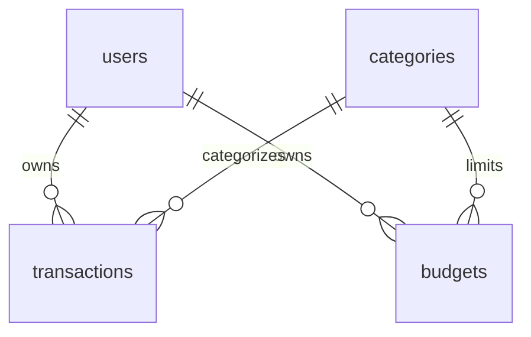

# Still — Personal Finance Dashboard

A full-stack personal finance app built with Java, Spring Boot, SQL, and vanilla JavaScript. Track income and expenses, plan category budgets, and review your month in a warm, glass-style dashboard.

[Source code](https://github.com/Shahran-Islam/Personal_Finance_Dashboard) · [Build and tests](https://github.com/Shahran-Islam/Personal_Finance_Dashboard/actions)

## Run it

With JDK 21+ installed, double-click `run-app.cmd` on Windows, or run:

```sh
./mvnw spring-boot:run
```

On Windows PowerShell use `.\mvnw.cmd spring-boot:run`. The Maven wrapper downloads Maven on first use. Open **http://localhost:8080**, choose **Create an account**, and register with a name, email, and a password of at least 12 characters. New accounts start empty. Use **Try it with sample data** to insert a fictional month, or add your own transactions.

The local H2 database persists in `data/`. Passwords are hashed; they cannot be recovered. Sessions expire after 30 minutes of inactivity. Restarting the server signs users out without deleting their records.

## Features

- Email/password registration, login, and logout with session cookies.
- A responsive overview with monthly balance, income, expenses, savings rate, a daily chart, spending breakdown, and budget progress.
- Transaction creation, editing, deletion, search, type filtering, and pagination.
- Monthly category budgets with remaining amounts and overspending indicators.
- Category reports and CSV transaction export.
- Optional fictional sample data, inserted only into an empty month.
- Server-side validation, CSRF protection, account ownership checks, and authentication rate limiting.

## Stack and structure

Java 21 · Spring Boot 3.5 · Spring Security · Spring JDBC · Flyway · H2 / PostgreSQL · HTML / CSS / JavaScript

```text
Browser -> Controller -> Service -> Repository -> SQL database
                       Security: session authentication + CSRF
```

`src/main/resources/static` contains the frontend. `controller` handles HTTP, `service` owns financial rules and transactions, `repository` contains parameterized SQL, and `security` configures authentication and resolves the current account. All assets are served by the app itself.

## Data model



Amounts use SQL `NUMERIC(12,2)` and Java `BigDecimal`. Budgets are unique by user, category, and month. Indexes begin with `user_id` to support account-scoped date and category queries. Date filters include the start of a month and exclude the start of the next. All amounts are USD.

V2 retains older anonymous rows with a null owner; those rows are inaccessible to accounts until an administrator deliberately assigns them. It never gives old data to the first person who registers.

## API

| Method | Path | Purpose |
| --- | --- | --- |
| GET | `/api/auth/csrf` | Obtain a CSRF token and header name |
| POST | `/api/auth/register` | JSON name, email, password; returns 201 |
| POST | `/api/auth/login` | Form-encoded email and password; returns 204 and session cookie |
| GET | `/api/auth/me` | Current account profile |
| POST | `/api/auth/logout` | Invalidate the session |
| GET | `/api/categories` | Predefined categories |
| GET / POST | `/api/transactions` | List by month / create |
| GET / PUT / DELETE | `/api/transactions/{id}` | Read / replace / delete an owned transaction |
| GET / POST | `/api/budgets` | List by month / create |
| GET / PUT / DELETE | `/api/budgets/{id}` | Read / replace / delete an owned budget |
| GET | `/api/summaries?month=2026-10` | Monthly totals and budget progress |
| POST | `/api/demo?month=2026-10` | Insert fictional data into an empty month |
| GET | `/health` | Public health check |

All financial endpoints require a session. All POST/PUT/DELETE requests require a CSRF token from `/api/auth/csrf`. Send the returned token in its named header and retain cookies. Get a fresh token after login or logout. Login uses `application/x-www-form-urlencoded`; registration and financial writes use JSON.

Transaction body:

```json
{"description":"Groceries","amount":42.75,"type":"EXPENSE","categoryId":3,"date":"2026-10-15"}
```

Budget body:

```json
{"categoryId":3,"month":"2026-10","amount":350}
```

List transactions with `?month=2026-10&limit=25&offset=0`. Limit is 1–100; offset must be nonnegative. PUT replaces editable fields. Positive amounts require at most two decimal places. Income/expense direction comes from type. Years 0001–9998 are accepted. Creates return 201, reads/updates 200, deletes 204, invalid input 400, unauthenticated reads 401, invalid CSRF 403, missing/unowned records 404, and conflicting budgets 409.

## Tests

```sh
./mvnw verify
```

The integration suite covers CRUD, validation, exact financial totals, month boundaries, password hashing, sessions, logout, CSRF, duplicate accounts/budgets, ownership isolation, and sample data. GitHub Actions runs it on Java 21.

Import `postman/Personal-Finance.postman_collection.json` and run it in order with the app running. The collection creates a disposable account, acquires CSRF tokens, logs in, tests the financial endpoints, and logs out. It removes the records it creates; the disposable test account remains. The frontend loads all pages for the selected month to generate reports; very large datasets would benefit from server-side reporting endpoints.

## Deployment and limits

See [deployment instructions](docs/DEPLOYMENT.md) for Docker/PostgreSQL and HTTPS hosting. The application includes a production configuration, but no hosting account is provisioned automatically. Run one instance until shared sessions/rate limiting are configured. Password recovery, email verification, MFA, and bank connections are not included.

[Code walkthrough](docs/WALKTHROUGH.md) · [Verification](docs/VERIFICATION.md) · [Portfolio description](docs/PORTFOLIO.md)

Author: [Shahran Islam](https://github.com/Shahran-Islam).
