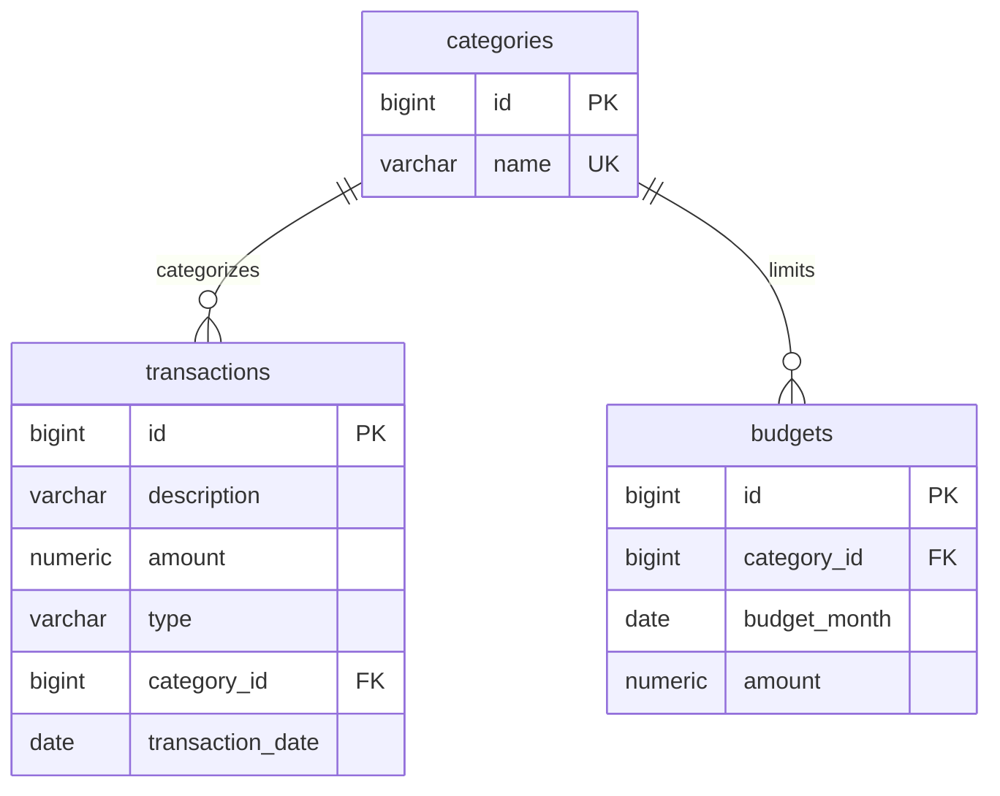

# Personal Finance Dashboard API

[Source code](https://github.com/Shahran-Islam/Personal_Finance_Dashboard) · [Build and tests](https://github.com/Shahran-Islam/Personal_Finance_Dashboard/actions)

A Java backend for recording income and expenses, setting monthly category budgets, and calculating financial summaries. Built by Shahran Islam as a portfolio project.

## Stack

Java 21, Spring Boot 3.5, Spring JDBC, SQL, Flyway, H2 for local development, and PostgreSQL for the Docker setup. The API returns JSON; validation errors use HTTP problem details.

## Run locally

Install JDK 21+ and Maven 3.6.3+ and run:

```sh
mvn verify
mvn spring-boot:run
```

The API runs at `http://localhost:8080/api`. The default H2 database persists in `data/finance.mv.db`. Flyway creates the tables and seven categories automatically. Transactions and budgets start empty. All amounts represent USD; this version does not convert currencies.

```sh
curl http://localhost:8080/api/categories
curl -X POST http://localhost:8080/api/transactions -H "Content-Type: application/json" -d '{"description":"Weekly groceries","amount":42.75,"type":"EXPENSE","categoryId":3,"date":"2026-10-15"}'
curl "http://localhost:8080/api/summaries?month=2026-10"
```

On Windows PowerShell, use the Postman collection or `Invoke-RestMethod`:

```powershell
$body = @{ description='Weekly groceries'; amount=42.75; type='EXPENSE'; categoryId=3; date='2026-10-15' } | ConvertTo-Json
Invoke-RestMethod http://localhost:8080/api/transactions -Method Post -ContentType application/json -Body $body
Invoke-RestMethod 'http://localhost:8080/api/summaries?month=2026-10'
```

## PostgreSQL with Docker

Copy `.env.example` to `.env`, set a local database password, then run `docker compose up --build`. The API is exposed only on localhost. Database storage persists in the `finance-data` volume. The container build runs the H2 integration tests; PostgreSQL runtime verification is a separate check.

## Endpoints

| Method | Path | Purpose |
| --- | --- | --- |
| GET | `/api/categories` | List predefined categories |
| POST | `/api/transactions` | Create a transaction |
| GET | `/api/transactions?month=2026-10&limit=25&offset=0` | List transactions, newest first |
| GET / PUT / DELETE | `/api/transactions/{id}` | Read, replace, or delete a transaction |
| POST | `/api/budgets` | Create a category budget |
| GET | `/api/budgets?month=2026-10` | List monthly budgets |
| GET / PUT / DELETE | `/api/budgets/{id}` | Read, replace, or delete a budget |
| GET | `/api/summaries?month=2026-10` | Income, expenses, balance, and budget progress |

Transaction body:

```json
{"description":"Weekly groceries","amount":42.75,"type":"EXPENSE","categoryId":3,"date":"2026-10-15"}
```

Budget body:

```json
{"categoryId":3,"month":"2026-10","amount":350.00}
```

Creates return `201` with a `Location` header; reads and updates return `200`; deletes return `204`. Invalid input returns `400`, missing records return `404`, and a duplicate category/month budget returns `409`. PUT replaces all editable fields. Amounts must be positive, have at most two decimal places, and fit `NUMERIC(12,2)`. Income/expense direction comes from `type`, not the sign of the amount. Supported years are 0001–9998.

Pagination uses a limit of 1–100 and a nonnegative offset. It is sorted by date and ID for consistent ordering. Categories are predefined and cannot be edited through this version of the API. A negative budget remainder indicates overspending. Summary totals include transactions even if their categories have no budget.

## Architecture and database

```text
HTTP request -> FinanceController -> FinanceService -> FinanceRepository -> SQL database
```

The controller handles HTTP and request validation. The service checks business rules and owns database transactions. The repository contains parameterized SQL. Records define the request and response shapes; database rows are not returned directly as unstructured maps.



Category names live in one table. A unique `(category_id, budget_month)` constraint prevents duplicate budgets. The service stores budget months as their first day. Transaction date and category/date indexes support monthly filtering and budget joins. Queries use inclusive start and exclusive next-month boundaries instead of extracting the month from every row. Amount calculations use SQL decimals and Java `BigDecimal`.

## Tests and Postman

`mvn verify` exercises the HTTP layer, service, SQL queries, and Flyway schema against H2. Tests cover transaction and budget CRUD, duplicate budgets, invalid amounts/categories, malformed input, missing records, pagination, empty summaries, exact decimal totals, overspending, and month boundaries.

Import `postman/Personal-Finance.postman_collection.json`, start the server, and run the collection in order. It saves created record IDs, checks status codes, and cleans up its transaction and budget. Use a fresh local database or a month/category without an existing budget. The collection is supplied for manual use; automated Spring tests are separate from running Postman.

GitHub Actions runs `mvn verify` on pushes and pull requests.

## Scope

This is a single-user backend demonstration. It has no login, per-user ownership, bank connections, or frontend. Keep it on localhost and use fictional data. Before exposing write endpoints publicly, add authentication, ownership checks, and deployment configuration. A future portfolio website can link to the repository and show a recorded demo or read-only sample responses.

See [the code walkthrough](docs/WALKTHROUGH.md) and [portfolio copy](docs/PORTFOLIO.md).

Author profile: [Shahran Islam](https://github.com/Shahran-Islam).

